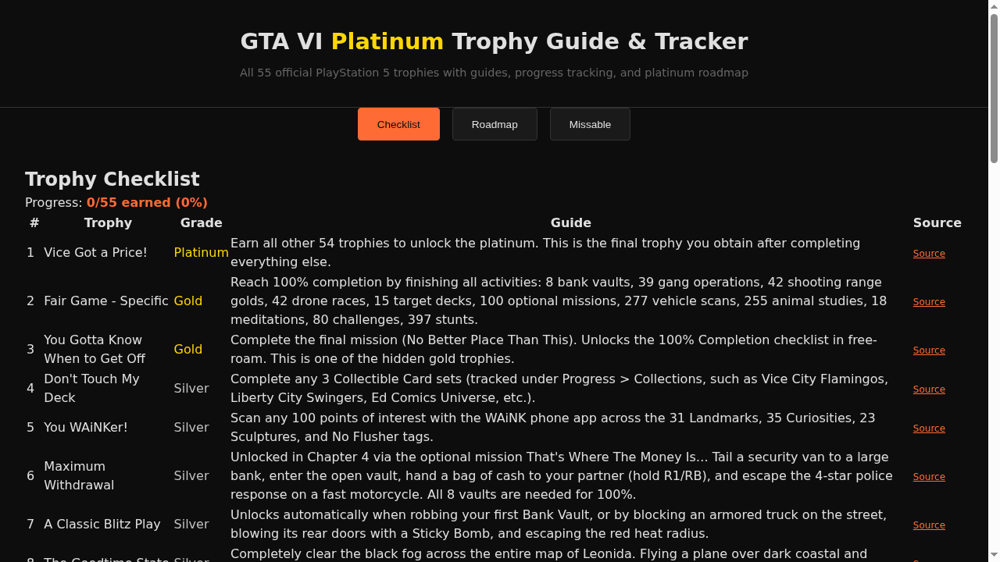
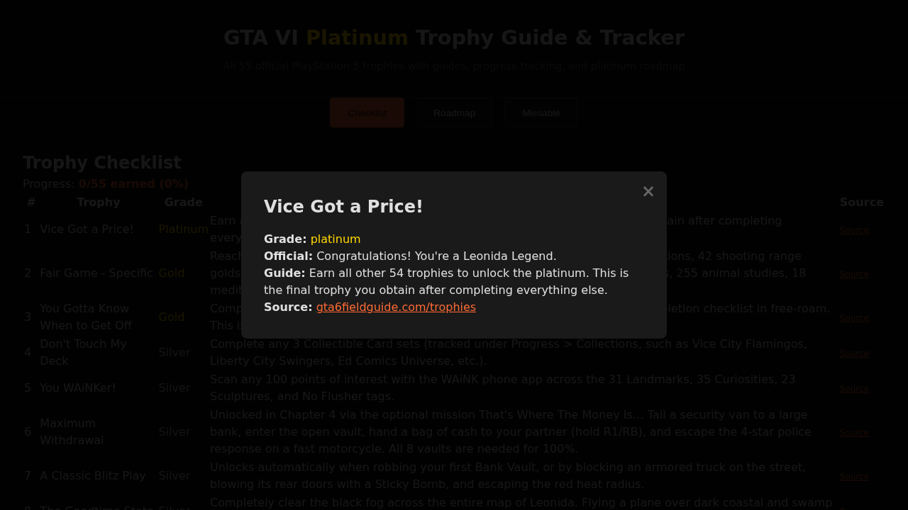
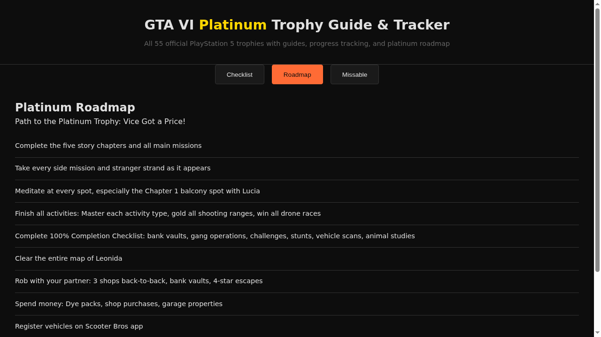
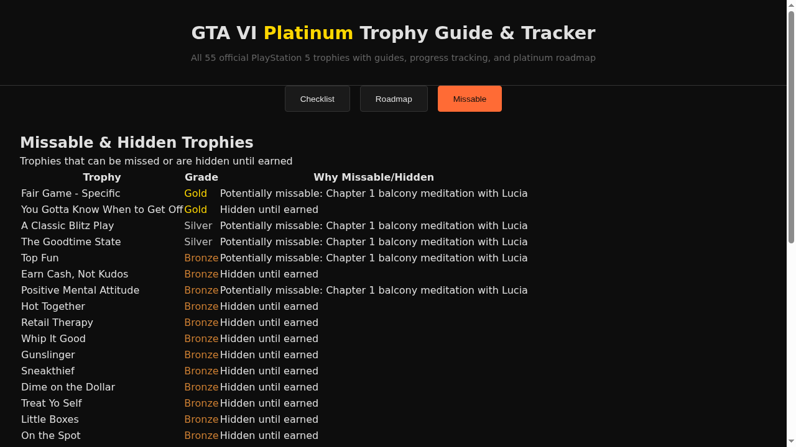

# GTA VI Trophy Guide & Tracker

All 55 official PS5 trophies for GTA VI with own-words guides, progress tracking, filters and a platinum roadmap.

## How to Play

1. **Clone the repo** or download the files
2. **Start the local server**: `cd app && python3 -m http.server 8123`
3. **Open your browser** to `http://127.0.0.1:8123/index.html`
4. **Navigate tabs** to switch between Checklist, Roadmap, and Missable views
5. **Click any trophy** to open a detailed modal with grade, guide, and source
6. **Use filters** to sort by grade, show missable only, or toggle spoilers
7. **Save progress** using Export/Import via localStorage

## Referral Code

`d14sycdw` - Use this code when signing up at [make.fun](https://make.fun/r/d14sycdw) to support this project.

## Trophy Distribution

- 1 Platinum, 2 Gold, 6 Silver, 46 Bronze = 55 total
- 37 Hidden, 1 Missable (Positive Mental Attitude)

## Screenshots

